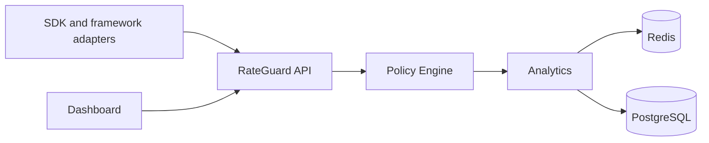

<p align="center">
  
</p>

<h1 align="center">RateGuard</h1>

<p align="center">
  <strong>He says nothing. He notices every token.</strong>
</p>

<p align="center">
  <strong>Centralized rate limiting for Node.js applications.</strong><br />
  A typed SDK, policy engine, backend API, dashboard, CLI, and framework adapters in one workspace.
</p>

<p align="center">
  
  
  
  
  
  
</p>

RateGuard helps teams define rate limits once and enforce them consistently across applications, APIs, and environments. The workspace includes a Node.js SDK, a CLI, a Fastify backend, a web dashboard, and adapters for common frameworks. It also includes policy simulation, analytics, health checks, and typed errors so operational behavior stays visible and predictable.

## What RateGuard Includes

- A typed SDK for programmatic checks, limits, middleware, health, and shutdown.
- A policy builder and compiler with templates, diffs, and simulation.
- A backend API built on Fastify with Redis and PostgreSQL integration.
- A dashboard with overview, analytics, logs, rules, integrations, settings, and auth flows.
- A CLI for setup, diagnostics, benchmarking, analytics, simulation, export/import, and migrations.
- Framework adapters for Express, Fastify, NestJS, Next.js, Koa, Hono, Bun, Deno, and Cloudflare Workers.

## Architecture



The SDK sends checks to the API. The API resolves policies through the policy engine, persists and reads operational state through Redis and PostgreSQL, and feeds the analytics surfaces used by the dashboard and CLI.

## Features

### SDK

- Builder-based configuration with runtime validation.
- `check`, `limit`, `middleware`, `health`, `shutdown`, and `dispose`.
- Typed fail modes: `failClosed`, `failOpen`, `warnOnly`, and `shadowMode`.
- Custom transports, retries, timeouts, and tenant scoping.

### Dashboard

- Overview, analytics, logs, rules, notifications, integrations, and settings.
- Auth flows for sign-in, sign-up, forgot password, and reset password.
- Documentation and integration pages for onboarding and support.

### CLI

- Bootstrap local config with `init`.
- Validate environment and backend connectivity with `doctor`.
- Persist credentials with `login`.
- Compile and simulate policies.
- Export, import, benchmark, analyze, and migrate.

### Analytics

- Overview summaries.
- Top endpoints, top attackers, top API keys, and heatmaps.
- Allowed-versus-blocked views and threat signal summaries.

### Security

- Explicit API key validation.
- Request IDs and correlation IDs.
- Redacted logs and structured error payloads.
- Health checks for backend, Redis, and migration state.

### Developer Experience

- Framework adapters for common Node and edge runtimes.
- Observability plugins for OpenTelemetry, Prometheus, Datadog, Sentry, New Relic, Elastic, Grafana, and custom exporters.
- Typed error classes with JSON serialization.
- Mock Redis fallback in development when no `REDIS_URL` is set.

## Quick Start

```bash
npm install @rateguard/node
```

```ts
import express from "express";
import { RateGuard } from "@rateguard/node";

const app = express();

const guard = RateGuard.builder()
  .apiKey(process.env.RATEGUARD_API_KEY ?? "")
  .baseURL(process.env.RATEGUARD_BASE_URL ?? "https://rateguard-7b9988e4d5f5.herokuapp.com/")
  .timeout(5000)
  .retry(2, 150)
  .failMode("shadowMode")
  .tenantId(process.env.RATEGUARD_TENANT_ID ?? "acme")
  .build();

guard.policy("login")
  .limit(10)
  .window("1m")
  .identifier((ctx) => ctx.identifier ?? ctx.ip ?? "anonymous")
  .endpoint("/login")
  .method("POST")
  .description("Protect the login route")
  .strategy("sliding-window")
  .build();

app.use(
  guard.middleware({
    failMode: "warnOnly",
    identifier: (req) => req.headers["x-user-id"]?.toString() ?? req.ip ?? "anonymous",
    endpoint: (req) => req.path,
    method: (req) => req.method,
    onDecision: async (result, req) => {
      if (!result.allowed) {
        req.app.emit("rateguard.blocked", result);
      }
    },
  })
);

app.post("/login", async (req, res) => {
  const decision = await guard.check({
    policy: "login",
    identifier: req.headers["x-user-id"]?.toString() ?? req.ip ?? "anonymous",
    endpoint: "/login",
    method: "POST",
  });

  if (!decision.allowed) {
    return res.status(429).json({
      error: "Rate limit exceeded",
      retryAfter: decision.retryAfter,
      policy: decision.policy,
      requestId: decision.requestId,
    });
  }

  return res.json({ ok: true });
});

process.on("SIGINT", async () => {
  await guard.shutdown();
  process.exit(0);
});
```

## Installation

### SDK

```bash
npm install @rateguard/node
```

### Workspace development

```bash
npm install
npm run build
```

### CLI

```bash
npx rateguard doctor
```

## CLI Examples

```bash
npx rateguard init
npx rateguard login --api-key rg_live_xxx --base-url https://rateguard-7b9988e4d5f5.herokuapp.com
npx rateguard doctor --api-key rg_live_xxx --base-url https://rateguard-7b9988e4d5f5.herokuapp.com
npx rateguard policy validate --policy rateguard.policy.json
npx rateguard simulate --policy rateguard.policy.json --identifier user_123 --endpoint /login --method POST
npx rateguard analytics --range 7d
npx rateguard benchmark --rounds 5
npx rateguard export --output rateguard.export.json
npx rateguard import --input rateguard.export.json
npx rateguard migrate
```

## Why RateGuard?

| Capability | Simple in-app limiter | RateGuard |
| --- | --- | --- |
| Configuration source | Embedded in application code | Centralized policies plus SDK configuration |
| Policy simulation | Usually unavailable | Built-in simulation and compilation |
| Health and diagnostics | Manual | `doctor`, `health`, and structured errors |
| Observability | Hand-rolled logging | Plugins for metrics and traces |
| Dashboard | Not included | Overview, analytics, rules, and logs |
| Framework coverage | Often one framework | Multiple adapters in one workspace |
| Operational rollback | Usually ad hoc | Policy versioning, templates, and diffs |

RateGuard is designed for teams that want a rate-limiting control plane instead of repeating limiter logic in each service.

## Project Structure

```text
.
|-- backend/            # Fastify API, auth, analytics, enforcement, database, Redis
|-- frontend/           # Dashboard UI
|-- packages/           # Framework adapters
|   |-- express/
|   |-- fastify/
|   |-- nest/
|   |-- next/
|   |-- koa/
|   |-- hono/
|   |-- bun/
|   |-- deno/
|   `-- cloudflare/
|-- rateguard-node/    # Publishable Node.js SDK and CLI
|-- docs/              # Documentation and guides
`-- benchmarks/        # Benchmarking scripts
```

## Tech Stack

- TypeScript
- Node.js 18+
- Fastify
- Express
- React
- Vite
- PostgreSQL
- Redis
- Zod
- `ioredis`
- `pg`
- `jsonwebtoken`
- `bcrypt`

## Deployment

The backend expects PostgreSQL, a JWT secret, and a configured fail mode. Redis is recommended for production and falls back to an in-memory mock only in development when `REDIS_URL` is absent.

- Docker and Docker Compose: see [docs/production-deployment.md](docs/production-deployment.md)
- Railway, Render, Fly.io, Vercel, AWS, DigitalOcean, and self-hosting: see [docs/production-deployment.md](docs/production-deployment.md)
- Reverse proxy and environment-variable reference: see [docs/production-deployment.md](docs/production-deployment.md)

## Roadmap

### Completed

- Builder-based Node SDK.
- CLI for initialization, diagnostics, policy simulation, analytics, and migrations.
- Framework adapters for Node, serverless, and edge runtimes.
- Backend enforcement endpoint at `/v1/check` and health endpoint at `/v1/health`.
- Dashboard pages for overview, analytics, rules, logs, integrations, settings, and docs.

### In Progress

- Documentation normalization across the full workspace.
- Operational hardening and deployment guides.
- Expanded examples for policies, plugins, and framework adapters.

### Future

- Additional observability integrations.
- More dashboard drill-downs and reporting views.
- Release automation and package publishing polish.

## Contributing

Start with [CONTRIBUTING.md](CONTRIBUTING.md). If you are changing public behavior, update the relevant docs and add tests in the same change.

## Security

Read [SECURITY.md](SECURITY.md) for supported versions, responsible disclosure, secrets handling, and threat-model guidance.

## License

The SDK and adapter packages are MIT licensed. The backend package currently uses ISC. See the package manifests and [rateguard-node/LICENSE](rateguard-node/LICENSE) for details.

## Support

- Open an issue for bugs or documentation gaps.
- Run `npx rateguard doctor` before filing backend or environment reports.
- Check the guides in `docs/` for setup, deployment, and troubleshooting.

## FAQ

### Does RateGuard work without Redis?

Yes in development, where the backend can use an in-memory mock Redis instance if `REDIS_URL` is not set. Production should use a real Redis instance.

### Which environment variables are required?

The backend requires `DATABASE_URL`, `JWT_SECRET`, `PORT`, and `RATE_LIMIT_FAIL_MODE`. The SDK requires `RATEGUARD_API_KEY` and a valid `baseURL`.

### What does `shadowMode` do?

It evaluates a policy without blocking requests, which is useful for rollouts and policy tuning.

### How do I verify a new setup?

Run `npx rateguard doctor` and review the configuration, DNS, TLS, backend, Redis, and migration checks.

### Can I use RateGuard without the dashboard?

Yes. The SDK, CLI, and backend can be used independently, but the dashboard becomes useful once you want analytics and operational visibility.

---

If RateGuard is useful in your stack, contributions are welcome. Documentation fixes, adapter improvements, and production examples all help the project grow in a maintainable way.
