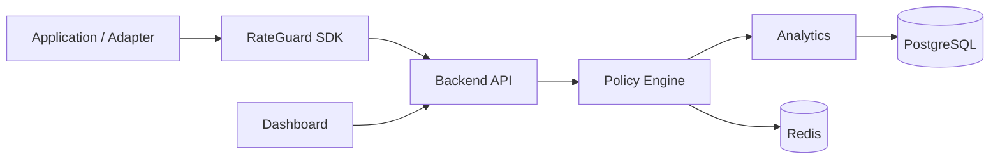

# Architecture

RateGuard is organized as a control plane plus adapters:

1. The SDK and framework adapters collect request context.
2. The backend API authenticates the caller and evaluates a request.
3. The policy engine compiles and simulates policy definitions.
4. Analytics read from persistent state and expose dashboard-ready summaries.
5. Redis stores operational counters and short-lived decision state.
6. PostgreSQL stores durable configuration, auth, rules, and reporting data.

## Request Flow

## Backend Layout

- `backend/src/modules/auth` handles sign-in, sign-up, password reset, and session checks.
- `backend/src/modules/enforcement` evaluates rate-limit decisions for `/v1/check`.
- `backend/src/modules/analytics` serves analytics and threat summaries.
- `backend/src/modules/rules` manages policy rules.
- `backend/src/modules/api-keys` manages API keys and rotation.
- `backend/src/modules/overview` powers summary views used by the dashboard.
- `backend/src/modules/gateway` handles proxy-style forwarding.

## SDK Layout

- `RateGuardBuilder` resolves configuration and creates a client.
- `RateGuardClient` sends checks to the backend.
- `PolicyBuilder` stores policy definitions in the local registry.
- `PolicyCompiler` compiles, validates, simulates, and diffs policies.
- `PluginRegistry` runs lifecycle hooks and injects services.

## Operational Notes

- The backend requires PostgreSQL and a JWT secret.
- Redis is recommended for production. In development, the backend can fall back to an in-memory mock if `REDIS_URL` is not set.
- The SDK uses fail modes to control behavior during backend or network failures.

## Related Docs

- [API Reference](api-reference.md)
- [Production Deployment](production-deployment.md)
- [Security Guide](security-guide.md)
- [Performance Guide](performance-guide.md)
